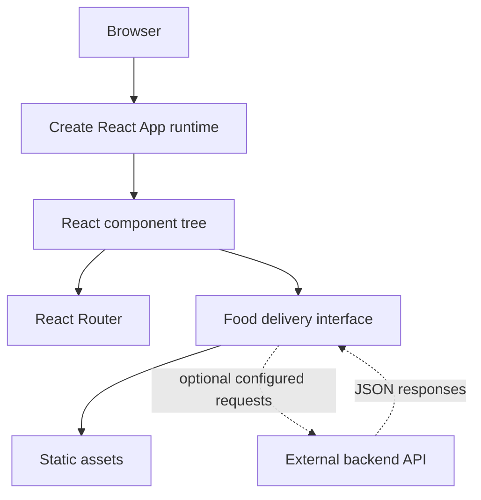

# Delight Food Delivery Frontend

A React single-page frontend for a food-delivery experience. The repository is built with Create React App and React Router, and is intended to demonstrate the customer-facing presentation layer of a food ordering product.

> **Project scope:** This repository contains the frontend only. Do not assume that restaurant discovery, cart persistence, checkout, payments, order tracking, authentication, or delivery dispatch are backed by a production service unless a corresponding API is configured and verified.

## Overview

The application is structured as a React application with a conventional Create React App development and production toolchain. React Router is available for client-side navigation. The UI is served locally by the development server and can be built into static assets for deployment to a compatible static host.

## Technology

- React 18 and React DOM
- Create React App / `react-scripts`
- React Router DOM 6
- Testing Library packages for component tests
- Web Vitals for performance measurement

## Getting started

### Requirements

- Node.js LTS compatible with the installed `react-scripts` version
- npm
- Git

### Install

```bash
git clone https://github.com/Brajesh31/Delight-Food-Delivery-Frontend.git
cd Delight-Food-Delivery-Frontend
npm ci
```

### Run locally

```bash
npm start
```

Open [http://localhost:3000](http://localhost:3000). The development server reloads when source files change.

### Available scripts

| Command | Purpose |
| --- | --- |
| `npm start` | Start the local development server |
| `npm test` | Run the Create React App test runner |
| `npm run build` | Create an optimized production build in `build/` |
| `npm run eject` | Eject the CRA configuration, an irreversible operation |

Avoid `npm run eject` unless there is a concrete requirement that cannot be met through the existing toolchain.

## Application architecture

The frontend runs in the browser. React renders the interface, and React Router handles in-app navigation. Static assets are served by the development server or copied into the production build. Any remote data, user identity, order state, or payment state must come from a separately implemented backend.



## Repository layout

```text
.
├── public/                 # Public static assets and HTML shell
├── src/                    # React application source
├── package.json            # Scripts and dependencies
├── package-lock.json       # npm dependency lockfile
└── README.md
```

The exact component and route organization should be read from the current `src/` tree. This guide deliberately avoids claiming backend capabilities that are not part of this frontend repository.

## Development workflow

1. Create a focused branch for the change.
2. Install dependencies with `npm ci`.
3. Start the app with `npm start`.
4. Make UI changes within the existing component and styling conventions.
5. Add or update tests for behavior that can be exercised without a live backend.
6. Run `npm test` and `npm run build`.
7. Submit a pull request with screenshots for visual changes and notes about viewport coverage.

## Quality and accessibility

- Use semantic HTML for navigation, forms, buttons, and headings.
- Give meaningful images useful alternative text. Decorative images should use empty alt text.
- Ensure interactive controls are keyboard accessible and show visible focus states.
- Keep loading, empty, error, and success states distinguishable.
- Test responsive layouts at mobile, tablet, and desktop widths.
- Do not place credentials or private API tokens in browser-delivered source code. A value bundled into a React application is public.

## Backend integration boundary

If the frontend is connected to a backend, document the exact API base URL and endpoint contracts before enabling integration-specific behavior. Prefer environment configuration for public API origins, such as a CRA `REACT_APP_*` variable. Never put server secrets in `REACT_APP_*` variables. Validate authentication and authorization on the server, not in the browser.

## Deployment

Run `npm run build` and publish the generated `build/` directory to a static hosting provider. Configure the host to serve `index.html` for client-side routes so refreshing a nested route does not return a 404. Set any public environment variables at build time and rebuild after changing them.

## Troubleshooting

| Symptom | Checks |
| --- | --- |
| Port 3000 is busy | Accept the alternate port prompt or stop the process using port 3000 |
| Dependencies fail to install | Use a supported Node.js LTS version and run `npm ci` from the lockfile |
| Blank page | Inspect browser console errors, asset paths, and runtime exceptions |
| Nested route returns 404 after refresh | Configure the static host's SPA fallback to `index.html` |
| API request fails | Verify the configured API origin, CORS policy, network response, and server availability |
| Build fails | Review the first compiler error, not only the final summary |

## Security

Report vulnerabilities privately to the repository maintainer. Do not commit credentials, personal data, real customer records, or production payment information. See [SECURITY.md](SECURITY.md).

## Contributing

Read [CONTRIBUTING.md](CONTRIBUTING.md) before opening a pull request. Please include reproduction steps for bugs and screenshots for visual changes.

## Project governance

- [Code of Conduct](CODE_OF_CONDUCT.md)
- [Security Policy](SECURITY.md)
- [Contribution Guide](CONTRIBUTING.md)
- [Bug Report](.github/ISSUE_TEMPLATE/bug_report.yml)
- [Feature Request](.github/ISSUE_TEMPLATE/feature_request.yml)

## License

This project is distributed under the MIT License. See [LICENSE](LICENSE) for the full text.
