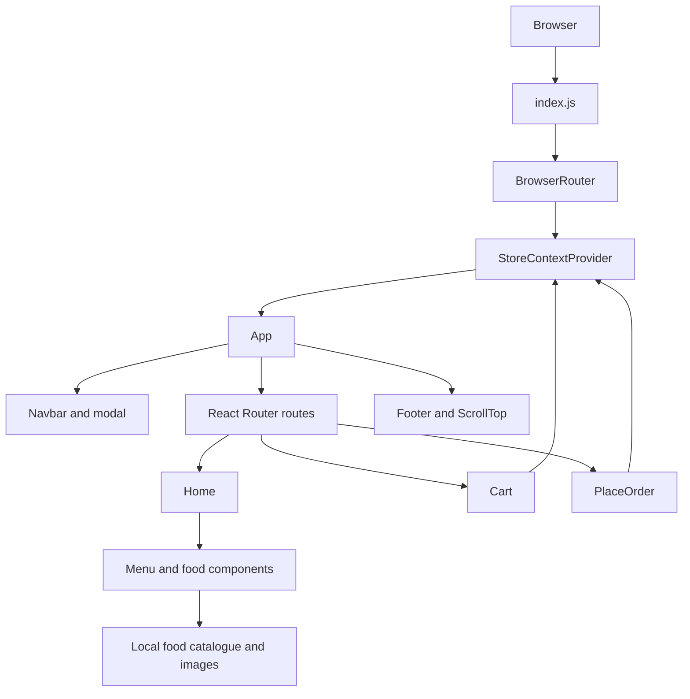

# Architecture

## System boundary

This repository is a React single-page frontend built with Create React App. It renders in the browser. It has no backend service in this repository and no verified API contract. Food catalogue data is imported from local JavaScript assets, and cart state is held in React Context.

## Runtime composition

## Entry points

- `src/index.js`: imports global CSS, creates the React root, and wraps the application in BrowserRouter and StoreContextProvider.
- `src/App.js`: owns the login modal visibility state, renders the navigation, route table, footer, and scroll-to-top control.
- `src/context/StoreContext.jsx`: provides the static catalogue, cart item quantities, cart operations, subtotal calculation, and delivery fee.

## Routes

| Path | Component | Responsibility |
|---|---|---|
| `/` | `Home` | Hero, menu category selector, filtered food list, mobile app promotion |
| `/cart` | `Cart` | Cart rows and totals |
| `/orders` | `PlaceOrder` | Delivery information fields and totals summary |

The `/orders` route is named like an order flow, but the current component only renders a form layout. It does not submit data or create an order.

## Component responsibilities

- `Navbar`: home navigation, in-page anchors, cart link, and sign-in modal trigger.
- `Header`: promotional hero and menu call-to-action presentation.
- `ExploreMenu`: category selection from the local menu list.
- `FoodDisplay`: filters the catalogue by selected category.
- `FoodDisplayItem`: displays one food item and cart quantity controls.
- `Cart`: renders selected catalogue entries and calculates totals.
- `PlaceOrder`: displays delivery fields and a cart total summary.
- `LoginSignup`: modal presentation for sign-up/login fields. It has no authentication request.
- `Footer`: static content and social imagery.
- `MobileApp`: app-store promotional imagery.
- `ScrollTop`: scroll-position listener and return-to-top button.

## Styling

The project uses CSS Modules for most component and page styles, plus global rules in `src/index.css`. Keep component-specific selectors in their modules. Global changes can affect the full application.

## State and data

The food catalogue is static and imported from `src/assets/assets.js`. The cart object maps each item ID to a quantity. Context avoids prop-drilling the cart operations into nested components. There is no persistence layer, server cache, or cross-device synchronization.

## Integration boundary

Any future API must be introduced as a separately documented integration. The frontend must not be treated as authoritative for prices, user identity, order validity, payment completion, or delivery status. The backend must validate all business-critical values.
